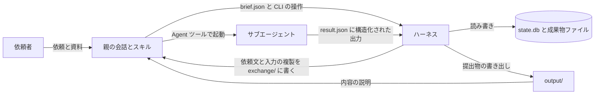

# 構成と技術選択

このスキルは、説明文の集まりではなく、実際にサブエージェントを起動して状態を管理する実行プログラムを含む。ここでは各部分の責任と、技術を選んだ理由を記す。

## 責任の分担

| 部分 | 責任 | 実装 |
| --- | --- | --- |
| スキル | 依頼を解釈し、必要な資料・成果物を定め、ハーネスの開始・状況確認・再開を案内する | `SKILL.md` |
| エージェント | 根拠を調べ、成果物を作り、批判に応答し、修正する。完了状態を直接書き換えない | 親の会話が Agent ツールで起動するサブエージェント（端末だけで動かす場合は `claude -p` の別プロセス） |
| 親の会話 | ハーネスが出した依頼を受け取り、そのままサブエージェントへ渡し、完了をハーネスへ知らせる。依頼文と結果は読まない | `pbteam.py pending`、`pbteam.py done` |
| スケジューラー | 依存関係、優先順位、同時実行数、予算に基づいて実行可能な仕事を選ぶ | `harness/scheduler.py`、`harness/engine.py` |
| 状態・成果物の保存 | 作業、入力版、出力版、根拠、発言、検査、実行イベントを永続化する | `harness/store.py` |
| 実行権の管理 | 二重実行の防止、遅れて届いた結果の排除、実行の占有 | `harness/leases.py` |
| 品質ゲート | 形式検査と内容検査を確認し、受理・差し戻し・保留を判断する。完了条件の判定は `Store.can_complete` が行う | `harness/gate.py`、`validators/`、`harness/store.py` |
| 発言の受け渡し | 実際の発言を宛先のセッションへ転送し、応答と再評価を記録する | `harness/debate.py` |
| 更新の影響 | 変更された根拠・主張を参照する下流だけを再確認する | `harness/impact.py` |
| 実行基盤との接続 | 利用可能なエージェント実行機能に依頼を送り、結果・失敗・使用量を受け取る | `adapters/` |
| 報告 | 保存された状態から提出物を作る。記録にないことを書き足さない | `harness/report.py` |

形式検査（必須項目、ID参照、版、ファイル存在、状態遷移）はコードで確認する。内容検査（主張が根拠に支えられるか、比較に意味があるか、次工程が利用できるか）は別担当のエージェントが評価する。参照先が存在することと、その参照先が主張を裏づけることを混同しない。AIの採点を正しさの保証とはしない。

コードの検査が文字列の比較で意味を推し量る場合（資料間の対象の違い、成立条件の脱落、数値の定義の違い）は、欠陥と断定せず、内容検査への確認依頼にする。実エージェントでの実行で、正当な言い換えを不合格にし続けたためである。一方、開発予定の機能の語や「唯一」などの断定表現のように、誤りの代償が大きく文脈で判断できる検査は、提供しないことを説明する節や「」で挙げた語を除いたうえで、拒否に使う。

## 実行の流れ

図の四角は処理、矢印はデータの流れを表す。

エージェントの出力はすべてハーネスの `submit_result` を通る。ここで実行権を確かめ、状態を変更しようとする項目を拒否し、形式を検査する。状態の変更は `Store.transition` だけが行い、遷移表と完了条件をここで確かめる。

## 技術選択と確認の記録

選択の基準は、必要な永続化、条件分岐、再開、実サブエージェントの呼び出し、検査を支えられるかである。次の内容は、2026-11-06 に Claude Code 2.1.318 で小さな実行を行って確かめた。

| 確かめたこと | 結果 |
| --- | --- |
| `claude -p --output-format json` の起動 | 動作した。`session_id`、`usage`、`total_cost_usd` が返る |
| `--json-schema` による構造化された結果 | `structured_output` に返る |
| `--resume <session_id>` での継続 | 以前の内容を保持し、転送した発言へ応答した |
| 存在しないセッションの再開 | 終了コード1と `No conversation found` が返る。`session_lost` として扱う |
| `total_cost_usd` の意味 | 再開すると `modelUsage` の値が増え、セッション内の累計である。差分を試行の費用にする。`costBasis` は `list` で定価換算である |
| `--restricted --safe-mode --strict-mcp-config` | 認証を保ったまま動作した。ファイル操作を作業フォルダーの中に限り、利用者の CLAUDE.md やスキルを読み込まない |
| `--settings '{"disableAllHooks":true}'` | 親の環境のフック（声の報告など）で子のプロセスが止まることを防ぐ |

実行基盤には、2026-11-07 から Agent ツールを既定にした。最初は `claude -p` の別プロセスを使っていたが、子のプロセスが接続先と認証を自分で読み込み直すため、親の会話と子の接続先が食い違った。特に `--restricted` はユーザー・プロジェクト・ローカルの設定ファイルを読まないので、設定ファイルに書いた Bedrock の設定が子に届かず、`Not logged in` で止まることを確かめた。ほかにも、英語のエラー文の判定、出力 JSON の細かい項目、新しいオプションの動きに依存していた。Agent ツールのサブエージェントは親の会話と同じ接続先と認証で動くので、親の会話が動く環境なら動く。

ハーネスは親の会話の外のプロセスで動くので、Agent ツールを直接呼べない。そこで、ハーネスが依頼文、作業手順、出力形式を `exchange/<試行>/` に書き、親の会話が `pending` で受け取ってサブエージェントを起動し、サブエージェントが `result.json` に結果を書き、親の会話が完了の通知を受けて `done` を実行する。親の会話は依頼文と結果を開かないので、結果はサブエージェント自身の出力のまま届く。ただし、親の会話が結果に手を加えていないことを仕組みで証明はできない。

`claude -p` の `--resume` で行っていた同じ担当の継続は、インスタンスごとに以前の依頼と結果のファイルを `exchange/sessions/` に記録し、新しいサブエージェントに順に読ませる方式に置き換えた。同じ会話の記憶を保つ方式ではない。一方、記録は実行フォルダーにあるので、親の会話が終わっても続きから再開できる。親の会話の会話履歴を実行状態の正本にしないという要件も、この方式で保てる。

親の会話が依頼を受け取らないまま一定時間（既定300秒）がたつと、試行を `not_dispatched` として打ち切り、実行を一時停止する。作業の失敗ではないので、再試行の回数と呼び出しの予算を消費しない。

特定のワークフローのフレームワークは採用していない。必要なのは条件分岐、再開、検査であり、標準ライブラリで足りるためである。

保存に SQLite を選んだ理由は、状態遷移と実行権の発行を一つのトランザクションにできるからである。例えば実行権の発行は `UPDATE ... WHERE state='ready'` の結果で判定し、二重の発行を防ぐ。Python の標準ライブラリに含まれ、追加の導入が要らない。成果物は読みやすさと差分確認のために Markdown ファイルとし、一時ファイルへ書いてから置き換えて公開する。

相互通信は、ハーネスが発言を転送する方式にした。サブエージェント同士の直接通信に頼らず、どの実行基盤でも同じ記録を残すためである。親が記録を保持し、宛先のセッションへ実際の発言の全文を渡すので、依頼書の「直接通信できない環境」の方式にあたる。別の実行基盤を使う場合は `adapters/base.py` の `Adapter` を実装する。`probe` が実際に確かめた結果だけを実行の可否の判断に使う。

## 模擬実装と実接続の区別

`adapters/mock.py` は状態制御の試験専用である。結果には `simulated` が付き、記録と報告に「模擬」と表示される。模擬の成功を実接続や実品質の証拠にしない。`adapters/injecting.py` は評価のために不良成果物を差し込むもので、差し込みは `injected_output` として記録する。

| 水準 | 意味 | 確認の方法 |
| --- | --- | --- |
| 設計のみ | 文書と定義だけがある | 読んで確認する |
| 模擬実行済み | 状態制御が動く | `tests/`（模擬実装） |
| 実エージェント接続済み | 起動、継続、発言の受け渡しが動く | `pbteam.py probe`（Agent ツール）、`evals/run_e2e.py`（`claude -p`） |
| 内容品質評価済み | 不良成果物を実際に拒否し、良質な成果物を通す | `evals/run_quality_eval.py`、`evals/run_crossdoc_eval.py` |
| 規模検証済み | 実エージェントで大きな規模が動く | 現時点で未検証。模擬の負荷試験のみ |

実施した評価の結果と未検証の項目は `evals/results/README.md` に記録する。

## 制約

利用上限に達すると、実行は一時停止する。Agent ツールの方式では、親の会話がサブエージェントのエラー文を `done --error` で渡し、ハーネスが利用上限かどうかを判定する。上限の残量を事前に知る方法は確認できていない。定額プランでは並列を増やすと上限に達しやすいので、既定の同時実行数は1である。

Agent ツールの方式では、ハーネスは費用とトークン数を取得できない。提出物の費用欄は「取得できなかった」になる。

`claude -p` の方式では、サブエージェントのセッションは利用者の `~/.claude/projects/` に保存される。再開に必要なので削除しない。Windows では深いパスが260文字の上限に触れる場合があるので、実行フォルダーは短いパスに置く。
