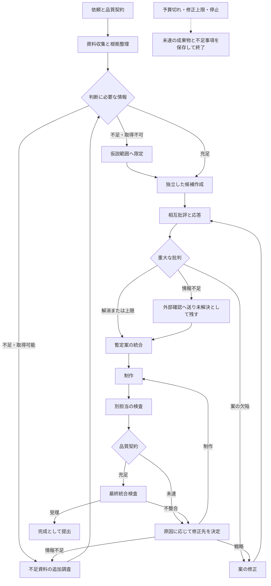

# 作業の編成と実行の制御

親の会話は依頼を整理し、ハーネスが作業を実行する。この文書は、作業がどう分解され、どの順に実行され、不合格や停止のときにどう動くかを説明する。実装は `harness/` にあり、定義は `graphs/` にある。

## 作業台帳

すべての仕事を作業台帳に登録する。各項目は、作業ID、目的、担当役割、入力資料と版、前提となる作業ID、具体的な作業内容、成果物の保存先、完了条件、検査担当、状態、期限または予算、失敗時の扱いを持つ。単に「市場を調査する」ではなく、「指定した代替手段の提供条件を同じ観点で比較し、根拠と未確認欄を付ける」のように成果を判断できる仕事にする。

台帳はグラフ定義から作られる。依頼範囲に該当する仕事がない役割は起動せず、理由を記録する。例えば、名称変更を扱わない依頼なら `D07` は対象外になり、構想段階では `C07`（継続・離脱）は対象外になる。競合が複数あるときは、担当が `requested_tasks` で競合別の作業を申請できる。ハーネスは役割、品質契約、目的、完了条件、残りの呼び出し数を確かめてから登録し、満たさなければ記録だけを残して登録しない。各エージェントが自由に増員することはできない。1役割を1体へ永久に固定せず、成果物と依存関係を基準に割り当てる。

## 状態

| 状態 | 値 | 意味 |
| --- | --- | --- |
| 未着手 | `pending` | 入力がそろっていない |
| 実行可能 | `ready` | 入力がそろい、実行の順番を待っている |
| 実行中 | `running` | 実行権を持つ試行がある |
| 検査待ち | `awaiting_review` | 成果物を提出し、別担当の検査を待っている |
| 修正中 | `revising` | 不合格になり、修正の作業がある |
| 完了 | `done` | 現行版に対する合格がある |
| 保留 | `on_hold` | 情報や判断が足りず、ここでは進められない |
| 失敗 | `failed` | 再試行や修正の上限に達した |
| 対象外 | `out_of_scope` | 実行前に、理由を付けて外した |

成果物が存在するだけで完了にしない。指定された比較項目や根拠があり、検査担当が完了条件を満たしたと判断し、ハーネスが判定したときに完了となる。エージェントの出力に状態を変える手段はなく、状態に関する項目が含まれていれば出力ごと拒否する。実行済みの作業を対象外へ変えることもできない。失敗を対象外にして未達を隠せないようにするためである。

不足情報を未確認として残すことが許される仕事では、その条件を品質契約に事前に示す。「仮説として比較する案」なら未確認の条件を残せるが、「実績を根拠にした事例記事」に実績がなければ、その成果物は保留である。

## グラフの三つの層

グラフは、役職を矢印で結んだ組織図ではなく、何を入力に何を作り、どの条件で次へ進むかを実行可能な形で表す。

作業グラフは `graphs/*.graph.json` に定義する。ノードは仕事の実行単位、`requires` の辺は必要な成果物への依存、`on` の辺は結果に応じた次の起動を表す。検査と修正は独立した作業として登録され、`intro_page.rev1`、`intro_page.fix1` のように試行ごとにIDと版が分かれる。テンプレートには修正の循環があってよいが、実行記録は循環せず、同じ作業が理由なく自己再実行されることはない。

根拠・成果物グラフは `links` テーブルに記録する。「参照する」「支持する」「反証する」「派生する」「検査する」を別の関係として扱い、資料間の派生は単なる参照、要約、推論、方針決定、媒体向けの表現変換を区別する。根拠が更新されたとき、再検査が必要な下流をここから追跡する。

討論グラフは `messages` と `issues` テーブルに記録する。どの批判へ誰が回答したか、どの修正が応答になっているかを追える。未回答の重大な批判がある間は、その主張を確定扱いにしない。

標準の分岐は次のとおりである。矢印は作業の実行条件を表す。実際のノード定義は `graphs/minimal.mmd` と `graphs/standard.mmd` にある。

開始前に `validators/graphcheck.py` が、存在しない依存先、到達できないノード、終了経路の欠落、上限のない循環、作成者と最終検査者の役割の同一性、独立候補同士の依存を検査する。予算切れや改善停止を完成ノードへ接続しない。並行する調査の合流では必須入力がそろったことを確認し、未完了の入力を省略して次へ進めない。ただし、依存の辺に `optional` と書いたものは、その担当が失敗した場合に未実施と記録して進める。

## 実行の順序

スケジューラー（`harness/scheduler.py`）は、依存関係、優先順位、同時実行数、残りの呼び出し数に基づいて実行可能な作業を選ぶ。調査や独立した制作は並行し、前工程の成果物が必要な仕事は待機させる。例えば C02 の業務整理と M03 の手作業比較は並行できるが、B03 の選択理由は両者の結果を参照して作る。

検査待ちが `review_backlog_limit`（既定4）以上になると新しい作成を止め、検査へ枠を割り当てる。作るだけで検査されない成果物が増えると、手戻りが後の工程へ持ち越されるためである。同時実行数は環境上限と依頼予算に合わせる。起動数を増やすこと自体を目的にしない。

## 上限

開始時に作業台帳から呼び出し数の上限を算出して記録する。依頼者の指定があればその値を使う。計測できない時間や費用は報告しない。既定値は運用上の初期値であり、品質が実証された最適値ではない。

| 項目 | 既定 | 上限に達したとき |
| --- | --- | --- |
| 相互批評の巡 | 3巡 | 未解決として提出する |
| 検査の差し戻し | 成果物ごとに2回 | 作業を失敗にし、実行全体を予算上限による未達で終える |
| 同一失敗の再試行 | 1回 | 未実施として記録する |
| 全体の呼び出し数 | 台帳から算出 | 予算上限による未達で終える |
| 横断検査のやり直し | 2回 | 予算上限による未達で終える |

## 検査で不合格になったとき

「もっと深く考える」と同じ指示を繰り返さない。欠陥を情報不足、推論の誤り、対象選択の問題、制作不足、成果物間の矛盾、検査の誤りに分類し、対応する作業へ戻す。

| 分類 | 値 | 差し戻し先 |
| --- | --- | --- |
| 情報不足 | `info_missing` | 追加調査。取得できなければ保留 |
| 推論の誤り | `inference_error` | 作成者が修正する。根拠が足りなければ主張を撤回または条件付きにする |
| 対象選択の問題 | `target_selection` | 採用された戦略へ戻す |
| 制作不足 | `production_gap` | 作成者が修正する |
| 成果物間の矛盾 | `cross_doc` | `fix_target` で示された成果物へ戻す |
| 検査の誤り | `review_error` | 作成者の反証を受け、検査担当が撤回できる |

例えば「共有表との違いが不明」という批判に対して、紹介文の言い換えを増やしても解消しない。追加比較を行い、違いを裏づけられなければ比較優位の主張を撤回する。一方、根拠はあるが文章から読み取れない場合は制作を修正し、同じ根拠を再調査しない。

修正後は、欠陥IDごとに何を変更し、何をもって解消したかを再検査する。検査担当は未解決の欠陥すべてに判定を返す必要があり、返さなければ検査が受理されない。修正前後の変更量が少ないのに欠陥が解消したと判定された場合は、別の検査担当が確かめる。語句の置換だけで合格になることを防ぐためである。ただし変更量は目安にすぎず、小さな修正でも正当なら合格する。

同じ重大欠陥が2回続いたら、単純な再生成を止め、原因診断（`diagnose`）を行う。診断の後は別のインスタンスが書き直し、別のインスタンスが検査する。この診断と書き直しは修正上限の2回の中で行い、呼び出しは全体の上限から消費する。その後も情報や実現条件が不足する場合は保留または失敗で終わる。費用や回数の上限に達したことを、品質達成と同一視しない。

検査は該当箇所と判断理由を提出し、提案者は `rebuttals` で反証できる。反証は次の検査担当へ渡される。重大な対立が解けなければ、平均点で合格にせず保留または条件付きの候補へ分ける。点数は判定に使わない。重大な欠陥が一つでもあれば、他の評価が高くても合格にしない。

## 品質契約の固定

品質契約は作業の開始時にハッシュ付きで保存する。失敗が続いたから検査基準を下げる、成果物を出さずに対象外へ変える、といった変更はできない。契約変更が必要なら `contract_changes` に依頼目的との関係と影響を記録する。記録があると、変更後の条件で合格しても実行全体は依頼者の判断待ちの保留で終わり、元の条件では未達と報告する。

## 更新の影響

資料や戦略の更新時は、変更された根拠・主張を参照する下流の成果物だけを再確認する。完了済みの全作業を毎回やり直さない。

資料を `update-source` で更新すると、登録済みの根拠の引用が新しい版に残っているかを確かめる。残っている根拠は有効のままとし、消えた根拠だけを無効にする。無効な根拠を引用する成果物の合格を取り消し、再確認の作業を登録する。別の資料を引用する成果物には影響しない。

成果物の新しい版が合格すると、主張の差分を計算し、変更された主張を `derived_from` で参照する下流の合格を取り消す。主張の単位で参照を記録せず入力としただけの下流は、細かく判断できないので影響ありとする。合格は成果物の版とハッシュに結びついており、v2 への合格を v3 へ流用できない。いずれの場合も、資料一式の横断検査の合格は無効になり、正しい版の組み合わせで再検査する。

## 停止と再開

状態は `state.db`（SQLite）に保存し、親の会話履歴を正本にしない。作業状態、入力の版、生成物の版、検査の対象版、実行者、試行ID、発言の送達状態、予算の消費を保存する。

| 状況 | 動作 |
| --- | --- |
| プロセスの停止 | 再開時に、実行中だった試行を `interrupted` にして作業を実行可能へ戻す。成功済みの作業は再実行しない |
| 保存途中の停止 | 成果物は一時ファイルへ書いてから公開するので、部分的なファイルは完成品にならない。残った一時ファイルは再開時に消す |
| 実行権の期限切れ | 試行を `timed_out` にして再試行する |
| 古い試行の結果が遅れて届く | 実行権の札が一致しないので現行版へ反映せず、`late_results/` に区別して保存する |
| 二つのプロセスが同じ実行を進めようとする | 実行の占有を確認し、後から来たプロセスは `locked` で止まる |
| 利用上限 | 再試行の回数を消費せず一時停止する |
| セッションを再開できない | 新しいインスタンスで継続し、引き継ぎを渡して記録する |
| 外部への変更を伴う作業 | `external_effect` のノードは自動で再試行せず保留にし、前回の操作の完了を確認する |

終了状態は、品質契約充足、仮説案の契約充足、資料不足による保留、予算上限による未達、実行失敗、中止に分ける。終了後に資料や成果物が更新された場合は、以前の終了状態を流用せず一時停止へ戻す。
